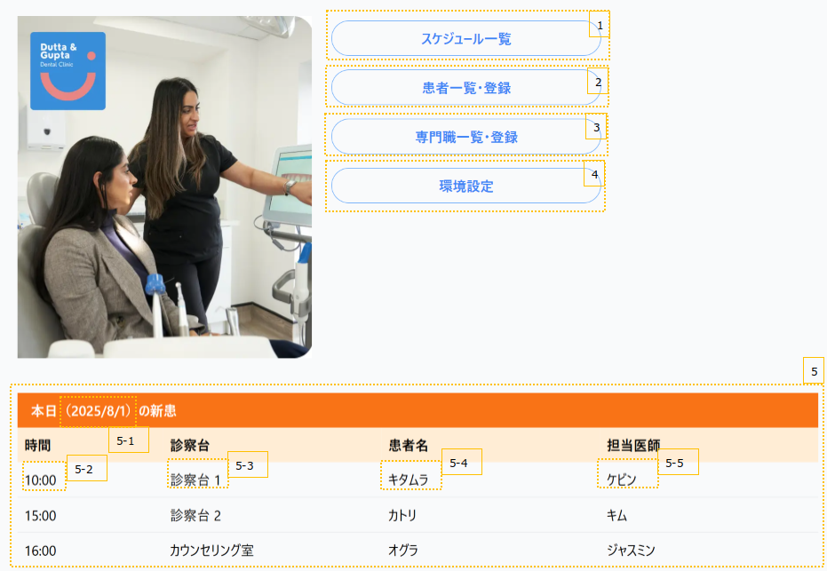
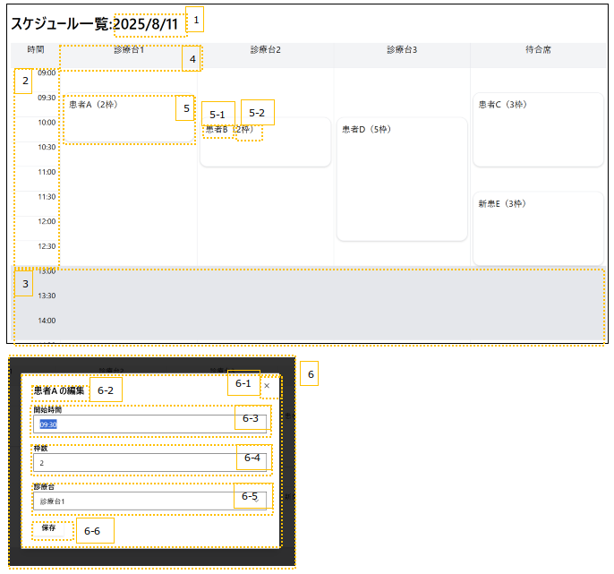

# 画面設計書

# 【トップ】URL: /  

## 1.全体図



## 2.画面定義

|no|項目名|種類|定義|備考|
|:----|:----|:----|:----|:----|
|1|スケジュール一覧|リンク|/schedule||
|2|患者一覧・登録|リンク|/patients||
|3|専門職一覧・登録|リンク|/professionals||
|4|環境設定|リンク|/setting||
|5|本日の患者|API|||
||||||

## 3.画面詳細

### [5]本日の新患

- 【API】
  - URL: /api/patients/today
  - Method: GET
  - レスポンス例（形式：json）
    ```json
    {
      {
        "id": "1",
        "time": 10：00,
        "room": "診察室1",
        "patient":"キタムラ"
        "doctor": "ケビン"
      },
      {
        ・・・
      }
    }
    ```

|no|項目名|型|変数名|例|備考|
|:----|:----|:----|:----|:----|:----|
|5-1|本日の日付|String|year + '年' + month + '月' + day + '日'|2025年8月5日|Date関数を使用|
|5-2|時間|String|patients.today.time|10:00||
|5-3|診察台|String|patients.today.room|診察台1||
|5-4|患者名|String|patients.today.patient|キタムラ||
|5-5|担当医|String|patients.today.doctor|ケビン||
|||||||


# 【スケジュール画面】URL: /schedule

## 1.全体図


## 2.画面定義

|no|項目名|種類|定義|備考|
|:----|:----|:----|:----|:----|
|1|日付|ラベル|year + '/' + month + '/' + day|初期値：現日時|
|2|時間|ラベル||初期値：30分単位|
|3|休憩時間|ラベル||環境設定に基づく|
|4|部屋|ラベル||環境設定に基づく|
|5|患者枠|API|押下時、患者予定編集モーダルが開く||
|6|患者予定編集|API|||
||||||

## 3.画面詳細

### [5]患者枠

- 【API】URL: /api/schedule/{date}
  - Method: GET
  - レスポンス例（形式：json）
    ```json
    {
      {
        "id": "1",
        "customer_id": "2",
        "customer_name": "診察室1",
        "duration":2,
        "room_id": "3",
        "room_name": "診察室３",
        "start_time": "2025-08-05T10:00:00",
      },
      {
        ・・・
      }
    }
    ```

|no|項目名|型|変数名|例|備考|
|:----|:----|:----|:----|:----|:----|
|5-1|患者名|string|schedule.{date}.customer_name|キタムラ||
|5-2|予約枠|int|schedule.{date}.duration|2||
||||||||


### [6]患者予定編集

- 【API】URL: /api/paitient/{id}
  - Method: GEtT
  - リクエスト例（形式：json）
    ```json
    {
      "customer_id": "2",
      "customer_name": "キタムラ",
      "start_time": "2025-08-05T10:00:00",
      "duration":2,
      "room_id": "3",
      "room_name": "診察室３",
    }
    ```
- 【API】URL: /api/paitient/edit/{id}
  - Method: POST
  - リクエスト例（形式：json）
    ```json
    {
      "customer_id": "2",
      "start_time": "2025-08-06T16:00:00",
      "duration":2,
      "room_id": "1",
    }
    ```

|no|項目名|型|変数名|例|備考|
|:----|:----|:----|:----|:----|:----|
|6-1|閉じる||||モーダルを閉じる|
|6-2|患者名|string|patient.{id}.name|キタムラ||
|6-3|開始時間|string|patient.{id}.start_time|10:00||
|6-4|予約枠|string|patient.{id}.duration|2||
|6-5|部屋|string|patient.{id}.room_name|診察室3||
|6-6|保存|API|||フォームの内容を基にデータを変更|
|||||||